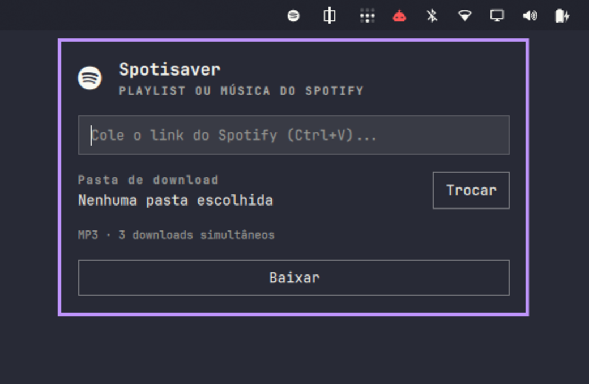

# Spotisaver for Omarchy

Download Spotify playlists and single tracks from the Omarchy bar, with live progress.

Click the music icon, paste a Spotify link with `Ctrl+V`, choose a folder, and press **Baixar**. The panel shows the percentage and the current track, and the bar icon gets a live percentage label while the download runs. Finished downloads show a desktop notification and an **Abrir pasta** button.



The panel UI is currently in Brazilian Portuguese.

## Requirements

- Omarchy Quattro (`omarchy-shell`)
- [`yt-dlp`](https://github.com/yt-dlp/yt-dlp)
- `zenity` for the folder picker
- The `spotisaver` helper from this repository

## Install

### 1. Install dependencies

Install `yt-dlp` and `zenity` from the Arch repositories with your package manager. Both are required at runtime.

### 2. Install the `spotisaver` helper

Download the latest release:

```sh
mkdir -p ~/.local/bin
curl -fL https://github.com/ghpo/spotisaver-rs/releases/latest/download/spotisaver \
  -o ~/.local/bin/spotisaver
chmod +x ~/.local/bin/spotisaver
```

Or build it from source:

```sh
cargo build --release
install -Dm755 target/release/spotisaver ~/.local/bin/spotisaver
```

Make sure `~/.local/bin` is in `PATH`. If you install the binary elsewhere, set the plugin's `binary` option to its full path.

### 3. Install the plugin

```sh
omarchy plugin add https://github.com/ghpo/spotisaver-rs.git --enable
omarchy bar move ghpo.spotisaver --section right --after omarchy.tray
```

## Usage

1. Click the Spotisaver icon in the bar.
2. Paste a link such as `https://open.spotify.com/playlist/...`, `https://open.spotify.com/track/...`, or a `spotify:` URI.
3. On the first download, pick a folder in the file chooser. The choice is remembered.
4. Press **Baixar** (or Enter). The panel closes while the folder picker is open so the picker can receive keyboard input, then reopens with progress.
5. Press **Cancelar** to stop. The helper kills its `yt-dlp` children cleanly.

Single tracks are saved directly in the chosen folder; playlists get a subfolder named after the playlist. Files are named `NNN - Artist - Title.ext`.

### Scripted use

```sh
omarchy-shell ghpo.spotisaver open
omarchy-shell ghpo.spotisaver download 'https://open.spotify.com/track/...'
omarchy-shell ghpo.spotisaver close
```

## Configuration

Set options with `omarchy bar set` or edit the plugin entry in `~/.config/omarchy/shell.json`:

```sh
omarchy bar set ghpo.spotisaver downloadDir '/home/you/Music'
omarchy bar set ghpo.spotisaver format m4a
omarchy bar set ghpo.spotisaver jobs 4 --json
omarchy bar set ghpo.spotisaver icon '󰓇'
omarchy bar set ghpo.spotisaver binary '/home/you/.local/bin/spotisaver'
```

| Key | Default | Description |
| --- | --- | --- |
| `icon` | `󰓇` | Bar glyph |
| `downloadDir` | empty | Download folder. Empty asks on the next download. |
| `format` | `mp3` | `yt-dlp` audio format (`mp3`, `m4a`, `opus`, ...) |
| `jobs` | `3` | Concurrent track downloads (1–8) |
| `binary` | `spotisaver` | Helper binary name or full path |

## Remove

```sh
omarchy plugin remove ghpo.spotisaver
rm -f ~/.local/bin/spotisaver
```

## Development

```sh
cargo test
cargo clippy --all-targets -- -D warnings
cargo build --release
omarchy plugin validate .
qmllint -I "$OMARCHY_PATH/shell" Spotisaver.qml
```

The plugin itself is `manifest.json` + `Spotisaver.qml`; the Rust crate builds the helper used by the plugin. `--json-progress` makes the helper print one JSON event per line (`start`, `track`, `progress`, `done`), which is what the panel consumes.

## How it works

`spotisaver` reads the public Spotify embed page for the playlist or track metadata, then downloads matching audio with `yt-dlp`'s `ytsearch1:` (one search per track). It does not use Spotify credentials or DRM. Playlist progress is aggregated across concurrent downloads, so the percentage advances as each track downloads.

Use this for content you are allowed to download. The plugin is not affiliated with Spotify, YouTube, or Omarchy.

## License

MIT. See [LICENSE](LICENSE).
